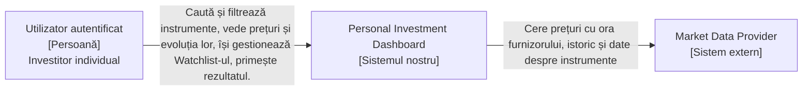

# Laboratorul 1: Personal Investment Dashboard

Cererea clientului: „Ajută-mă să îmi urmăresc investițiile."

## 1. Cercetarea produsului

**Întrebarea de cercetare:** Cum ajută produsele existente un Utilizator să urmărească informațiile despre piață și ce părți aparțin primei versiuni a acestui Dashboard?

Am analizat un produs cu date despre piață (Yahoo Finance) și un produs de tranzacționare (MetaTrader 5), folosind paginile publice de ajutor, fără cont.

| Produs | Utilizatorul probabil și obiectivul său | Model reutilizabil |
| ------ | --------------------------------------- | ------------------ |
| Yahoo Finance | Investitor individual care vrea să verifice rapid prețuri și evoluția unor instrumente și să-și păstreze listele proprii, fără să facă tranzacții în aplicație. | (a) Lângă preț se arată bursa și dacă prețul este în timp real sau întârziat. (b) Fiecare piață are o întârziere și un furnizor de date declarate. (c) Listele personale se văd și se modifică doar după autentificare. (d) O listă se creează, iar simbolurile se adaugă și se elimină din ea. |
| MetaTrader 5 | Trader activ, cu cont la un broker, care vrea să urmărească simboluri în detaliu, să analizeze grafice și să trimită ordine. | (a) O listă de simboluri cu preț de cumpărare și de vânzare, diferența dintre ele, minim/maxim ale zilei și variație procentuală, care poate fi sortată. (b) Evoluția unui simbol pe 21 de intervale de timp, de la 1 minut la 1 lună, deschisă direct din lista de simboluri. (c) Indicatori, ordine și roboți de tranzacționare (Expert Advisors) — **nu** se preiau. |

## 2. Părți interesate și actori

Metoda: cartografierea părților interesate  .

| Parte interesată | Motivație | Influență | Motiv |
| ---------------- | --------- | --------- | ----- |
| Utilizator (investitor individual, autentificat) | Ridicată | Scăzută | Folosește Dashboard-ul ca să urmărească instrumentele care îl interesează, dar un singur Utilizator nu poate schimba o decizie despre produs. |
| Echipa de produs (responsabil de produs, dezvoltatori) | Ridicată | Ridicată | Decide și răspunde de fiecare alegere despre produs. |
| Market Data Provider | Scăzută | Ridicată | Nu este interesat de acest produs anume, dar fără datele lui Dashboard-ul nu poate afișa nimic, iar condițiile lui (întârziere, limite de utilizare) fixează ce poate promite produsul. |
| Autorități de reglementare (piața de capital, protecția datelor personale) | Scăzută | Ridicată | Nu urmăresc produsul zilnic, dar pot impune reguli despre afișarea datelor financiare și despre datele personale legate de un cont. |

**Matricea motivație / influență**

| Motivație | Influență scăzută | Influență ridicată |
| --------- | ----------------- | ------------------ |
| Ridicată  | Utilizator | Echipa de produs |
| Scăzută   | Brokeri și platforme de tranzacționare | Market Data Provider, Burse, Autorități de reglementare |

**Clasificare**

| Candidat | Clasificare | Motiv |
| -------- | ----------- | ----- |
| Utilizator | Actor uman direct | Deschide Dashboard-ul, caută, filtrează și își gestionează Watchlist-ul. |
| Market Data Provider | Sistem extern | Dashboard-ul îi cere direct prețurile, istoricul și datele despre instrumente. |
| Echipa de produs | Altă parte interesată | Ia decizii, dar nu apare în fluxul Utilizatorului. |
| Burse | Altă parte interesată | Sunt sursa reală a prețurilor, dar Dashboard-ul nu comunică direct cu ele; datele ajung prin furnizor. |
| Autorități de reglementare | Altă parte interesată | Impun limite, dar nu interacționează cu produsul în funcționare. |
| Brokeri și platforme de tranzacționare | Altă parte interesată | Nu sunt conectați la Dashboard în prima versiune. |

## 3. Promisiunea și domeniul de aplicare ale produsului

**Promisiunea produsului:**

> **Personal Investment Dashboard** ajută **investitorul individual autentificat** să rezolve **dificultatea de a verifica rapid prețurile și evoluția instrumentelor pe care le urmărește, când informațiile sunt împrăștiate pe mai multe site-uri și nu arată clar cât de vechi este un preț**, astfel încât **să vadă într-un singur loc date pe care se poate baza și să știe cât de actuale sunt**.

**Obiective**

1. Utilizatorul vede, la fiecare vizită, ce instrumente au crescut sau au scăzut cel mai mult în ziua curentă.
2. Utilizatorul găsește un instrument după nume sau simbol.
3. Utilizatorul filtrează lista de instrumente după criterii precum tipul și sectorul.
4. Utilizatorul vede prețul curent al unui instrument, cu ora furnizorului sau întârzierea, și evoluția lui pe perioade selectabile, de la o zi la cinci ani.
5. Utilizatorul își păstrează o listă personală și privată de instrumente și o regăsește la fiecare vizită.

**Obiective excluse**

1. Prima versiune nu permite Utilizatorului să cumpere, să vândă sau să trimită ordine.
2. Nu oferă analiză tehnică: indicatori, desen pe evoluția prețului sau strategii automate.
3. Nu ține evidența portofoliului: cantități deținute, preț de achiziție, profit sau pierdere.

## 4. Cerințe funcționale

### DASH-1: Vedere de ansamblu a pieței

**Obiectivul actorului:** Utilizatorul vrea să afle în câteva secunde ce crește cel mai mult pe piață azi.

> Ca Utilizator autentificat, vreau să văd instrumentele cu cele mai mari creșteri și scăderi ale zilei, astfel încât să observ rapid mișcările importante ale pieței.

Definițiile de Făcut:
- Se arată cele mai mari creșteri și scăderi procentuale ale zilei, fiecare cu prețul și cu ora furnizorului sau întârzierea.
- Un instrument fără preț sau cu un preț mai vechi decât limita de vechime a produsului este marcat „indisponibil" și nu intră în clasament cu valoarea zero.
- Dacă nu există date acceptabile pentru niciun instrument, Utilizatorul vede un mesaj de eroare, nu o listă goală.

### DASH-2: Căutarea unui instrument

**Obiectivul actorului:** Utilizatorul vrea să ajungă direct la un instrument, fără să parcurgă toată lista.

> Ca Utilizator autentificat, vreau să caut un instrument după nume sau simbol, astfel încât să ajung direct la cel pe care îl caut.

Definițiile de Făcut:
- Se arată instrumentele care se potrivesc cu textul introdus, fie că este nume sau simbol.
- Dacă niciun instrument nu se potrivește, se arată explicit „niciun rezultat".

### DASH-3: Filtrarea instrumentelor

**Obiectivul actorului:** Utilizatorul vrea să vadă doar categoria care îl interesează.

> Ca Utilizator autentificat, vreau să filtrez instrumentele după tip și sector, astfel încât să mă uit doar la ce mă interesează.

Definițiile de Făcut:
- Se arată numai instrumentele care respectă toate filtrele alese.
- Dacă nicio combinație de instrumente nu respectă filtrele, se arată un mesaj explicit împreună cu filtrele active.
- Fiecare instrument din rezultat arată prețul cu ora furnizorului sau marcajul „indisponibil".

### DASH-4: Prețul și evoluția unui instrument

**Obiectivul actorului:** Utilizatorul vrea să afle cât costă un instrument acum și cum a evoluat.

> Ca Utilizator autentificat, vreau să văd prețul unui instrument și evoluția lui pe o perioadă aleasă, astfel încât să înțeleg dacă a crescut sau a scăzut și cât de actuală este informația.

Definițiile de Făcut:
- Se arată prețul curent cu ora furnizorului sau întârzierea, plus evoluția pe perioada aleasă dintre 1 zi, 1 săptămână, 1 lună, 6 luni, 1 an și 5 ani.
- Dacă prețul lipsește sau este mai vechi decât limita de vechime, se arată „indisponibil", niciodată zero și niciodată un preț prezentat ca actual.
- Dacă lipsește doar o parte din perioadă, se arată partea disponibilă, iar intervalul lipsă este marcat clar.
- Dacă nu se poate încărca nimic, Utilizatorul vede un mesaj clar, nu un rezultat gol.

### DASH-5: Watchlist personal

**Obiectivul actorului:** Utilizatorul vrea să își păstreze instrumentele preferate și să le regăsească fără să le caute din nou.

> Ca Utilizator autentificat, vreau să adaug și să elimin instrumente din Watchlist-ul meu personal, astfel încât să le regăsesc la fiecare vizită.

Definițiile de Făcut:
- După o modificare confirmată (adăugare sau eliminare), următoarea citire a Watchlist-ului de către același Utilizator arată conținutul actualizat.
- Un Watchlist gol are o stare goală explicită, iar un Watchlist care nu poate fi încărcat arată o eroare clară, nu o listă goală.
- Un alt Utilizator sau un vizitator neautentificat nu poate citi și nici modifica acest Watchlist.

## 5. C4 System Context

Furnizorul deține valoarea sursă; Dashboard-ul deține modul în care ea devine clară și sigură pentru Utilizator. Bursele nu apar în diagramă, pentru că nu comunică direct cu Dashboard-ul. Autentificarea este responsabilitatea Dashboard-ului, nu a unui sistem extern separat.

## Listă de verificare

- [x] Am cercetat cel puțin două produse existente.
- [x] Am citat dovezi pentru fiecare model de produs selectat.
- [x] Cercetarea mea a modificat sau a confirmat cel puțin o decizie despre domeniul de aplicare.
- [x] Am cartografiat motivația și influența părților interesate.
- [x] Am separat părțile interesate, actorii umani direcți și sistemele externe.
- [x] Promisiunea produsului meu este o propoziție clară.
- [x] Obiectivele și obiectivele mele excluse sunt compatibile cu promisiunea produsului.
- [x] Am scris cel puțin cinci povești de Utilizator.
- [x] Fiecare poveste are între două și patru definiții de Făcut.
- [x] Cel puțin două povești includ un rezultat alternativ important.
- [x] Dependențele mele externe includ un rezultat lipsă, învechit sau neacceptat, care este vizibil pentru Utilizator.
- [x] Am creat un C4 System Context view pentru Dashboard.
